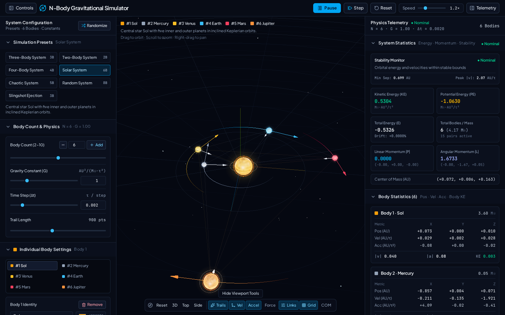
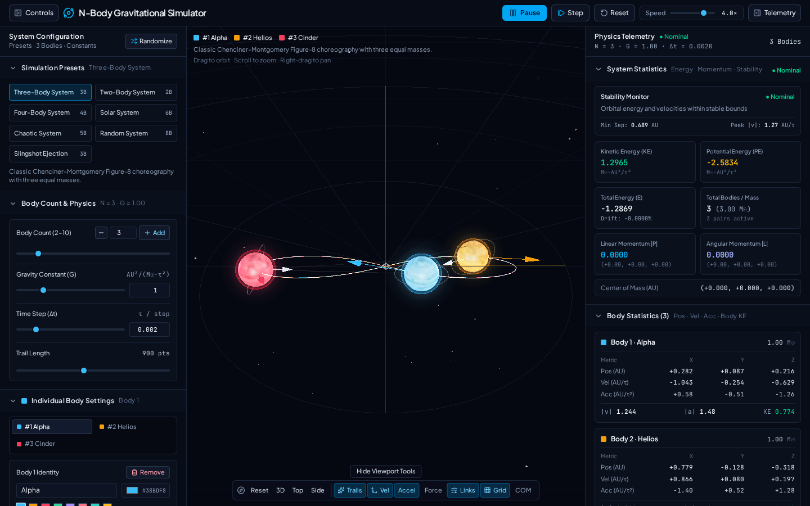
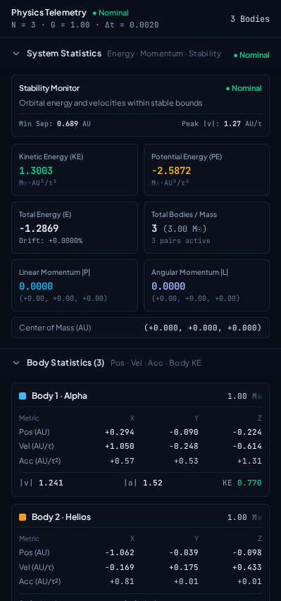
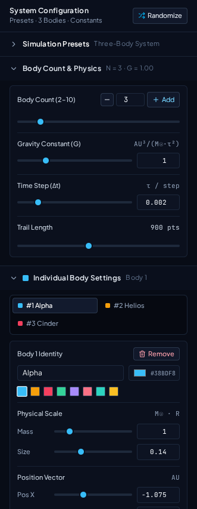

# N-Body Gravitational Simulator

> *Explore gravity. Simulate chaos. Visualize the universe.*

[](https://react.dev/)
[](https://www.typescriptlang.org/)
[](https://threejs.org/)
[](https://tailwindcss.com/)
[](https://vite.dev/)
[](https://opensource.org/licenses/Apache-2.0)
[](https://docs.github.com/en/actions)

An interactive, real-time 3D **N-Body Gravitational Simulator** built with React, TypeScript, and Three.js. Simulate **2 to 10 interacting celestial bodies** under Newtonian gravity using a **4th-order Runge–Kutta (RK4)** numerical integrator, complete with customizable orbital parameters, vector overlays, an automated stability monitor, and a synchronized physics telemetry dashboard.

**Live Demo:** `[Live Demo URL — Add your deployed application link here]`

---

## Screenshots & Preview

> **Note:** Capture screenshots of the running application and save them under `docs/images/` using the paths below to populate this gallery.

| Main 3D N-Body Simulation | Three-Body Figure-8 Choreography |
| :---: | :---: |
|  |  |
| *Multi-body 3D gravitational interaction with orbital trails and force links* | *Classic Chenciner–Montgomery Figure-8 periodic three-body orbit* |

| Real-Time Physics Telemetry Dashboard | Individual Body Configuration Panel |
| :---: | :---: |
|  |  |
| *Live energy, momentum, stability monitor, and per-body state cards* | *Per-body identity, color, radius, mass, position, and velocity controls* |

---

## Table of Contents

- [Features](#features)
- [User Guide](#user-guide)
- [Physics Model](#physics-model)
- [Physics Accuracy & Limitations](#physics-accuracy--limitations)
- [Tech Stack](#tech-stack)
- [Project Structure](#project-structure)
- [Getting Started](#getting-started)
- [License](#license)

---

## Features

### Dynamic N-Body Management (2–10 Bodies)
- Scale the simulation dynamically between **2 and 10 celestial bodies** via slider, numeric input, or **Add / Remove** controls.
- Customize every body individually:
  - **Name & Visual Color** (color picker + quick palette swatches reflected across core mesh, atmospheric halo, corona, vector arrows, and orbital trails)
  - **Physical Scale**: Mass ($M_\odot$) and visual radius ($\text{AU}$)
  - **3D State Vectors**: Position $(X, Y, Z)$ and Velocity $(V_x, V_y, V_z)$

### Predefined Orbital Presets
- **Three-Body System**: Classic Chenciner–Montgomery Figure-8 choreography with three equal masses.
- **Two-Body System**: Binary star pair orbiting a shared barycenter.
- **Four-Body System**: Symmetric four-body rosette in dynamic equilibrium.
- **Solar System**: Central star *Sol* with five planets (*Mercury*, *Venus*, *Earth*, *Mars*, *Jupiter*) in inclined Keplerian orbits.
- **Chaotic System**: Five asymmetric bodies exhibiting close gravitational exchanges and orbital shifts.
- **Random System**: Procedurally generated N-body configuration with zero net linear momentum (plus a one-click **Randomize** button).
- **Slingshot Ejection**: Close three-body encounter demonstrating gravitational slingshot acceleration and hyperbolic escape.

### RK4 Physics Engine & Stability Monitor
- Pairwise Newtonian gravity across all $N(N-1)/2$ interactions with configurable **Gravitational Constant ($G$)**, **Time Step ($\Delta t$)**, and gravitational softening ($\varepsilon = 0.015\text{ AU}$) to prevent close-encounter singularities.
- **Stability Monitor**: Continuously tracks close approaches, peak speeds, integration energy drift, and hyperbolic escape relative to the $(N-1)$-body subsystem center of mass—marking the system status **Unstable** and highlighting system energy cards in red during extreme velocity spikes or ejections.

### Interactive 3D Visualization
- Procedural surface maps, bump maps, Fresnel limb halos, equatorial rings, and additive corona sprites.
- Pooled dynamic point lights attached to the most massive active bodies.
- **OrbitControls** camera navigation (drag to rotate, scroll to zoom, right-drag to pan) plus quick camera presets (**Reset**, **3D**, **Top**, **Side**) and **Follow COM**.
- Independent overlays:
  - **Orbital Trails** with adjustable trail length (`50–2000` points)
  - **Velocity (`Vel`)**, **Acceleration (`Accel`)**, and **Net Gravitational Force (`Force`)** vector arrows
  - **Pairwise Gravity Links (`Links`)** scaled by interaction force magnitude
  - **Expanded Ecliptic Reference Grid (`Grid`)**: `24 AU` polar rings layered over a `48 × 48 AU` Cartesian reference grid

### Real-Time Telemetry Dashboard
- **System Statistics**: Active body count, total mass, Kinetic Energy ($KE$), Potential Energy ($PE$), Total Mechanical Energy ($E$) & conservation drift, Linear Momentum ($\mathbf{P}, |\mathbf{P}|$), Angular Momentum ($\mathbf{L}, |\mathbf{L}|$), and Center of Mass.
- **Individual Body Statistics**: Live $(X, Y, Z)$ position, velocity, acceleration, speed $|v|$, acceleration magnitude $|a|$, and individual kinetic energy $KE_i$ for every active body.
- **Orbital Pairs**: Pairwise distances, gravitational force magnitudes $|F_{ij}|$, pairwise potential energies $U_{ij}$, and orbital radius from COM.
- **Simulation Controls**: Play / Pause, **Single-Step**, Reset, Speed multiplier (`0.1× – 5.0×`), live FPS, and collapsible left/right panels to maximize the 3D viewport.

---

## User Guide

The workspace is organized into three collapsible regions: the **Left Configuration Panel** (`Controls`), the **Center 3D Viewport**, and the **Right Telemetry Dashboard** (`Telemetry`). Use the **Controls** and **Telemetry** buttons in the top bar at any time to collapse side panels and maximize the 3D canvas.

### Simulation Controls
- **Play / Pause**: Starts or pauses continuous real-time RK4 integration from the top bar.
- **Single-Step (`Step`)**: Pauses continuous playback (if running) and advances the simulation by one discrete integration tick so you can inspect trajectories step by step.
- **Reset**: Restores the currently selected preset's initial positions, velocities, masses, and physics constants (`G`, `Δt`), clearing existing orbital trails and resetting the camera.
- **Simulation Speed**: Adjusts playback rate from `0.1×` (slow motion) to `5.0×` (accelerated time evolution).
- **Time Step (`Δt`)**: Configures the integrator's base time step (`0.0005 – 0.01 τ` via slider, or `0.0002 – 0.02 τ` via numeric input) in **Body Count & Physics**. Smaller values improve accuracy during tight encounters.
- **Gravitational Constant (`G`)**: Scales the strength of gravitational attraction (`0.1 – 4.0` via slider, or `0.05 – 10` via numeric input) in **Body Count & Physics**.

### Body Management
- **Changing Body Count (`2–10`)**: Use the **Body Count (2–10)** slider, type a value into the numeric box, or click the **`-`** and **`+ Add`** buttons. Newly added bodies are placed in outer inclined orbits around the system's current center of mass.
- **Removing Individual Bodies**: Select any body in **Individual Body Settings** and click **Remove** (available whenever more than 2 bodies exist).
- **Customizing Body Properties**:
  - **Identity**: Edit the body's **Name** and choose any **Color** using the color picker or quick swatch buttons.
  - **Physical Scale**: Adjust **Mass** ($0.05\text{–}6.0\ M_\odot$ slider, minimum $0.05\ M_\odot$ numeric) and visual **Size** / radius ($0.04\text{–}0.35\text{ AU}$).
  - **State Vectors**: Fine-tune **Position (`Pos X/Y/Z`)** ($\pm 4.0\text{ AU}$) and **Velocity (`Vel X/Y/Z`)** ($\pm 3.5\text{ AU}/\tau$) via sliders or exact numerical inputs.
- **Using Presets & Randomize**: Choose any scenario under **Simulation Presets**, or click **Randomize** in the left panel header to generate a fresh randomized N-body system with zero net linear momentum.

### 3D Navigation
- **Rotate**: Left-click and drag anywhere inside the 3D viewport.
- **Zoom**: Scroll up/down with the mouse wheel or trackpad (`0.9` to `80` units from target).
- **Pan**: Right-click and drag to translate the camera target across space.
- **Camera Presets**: Click **Reset**, **3D**, **Top**, or **Side** in the bottom viewport dock for smooth damped camera transitions.
- **Follow Center of Mass (`COM`)**: Toggle **COM** in the bottom viewport dock to keep the camera target smoothly locked onto the system's moving barycenter during playback.

### Visualization Overlays
Toggle individual 3D overlays from the bottom viewport dock (**Show / Hide Viewport Tools**):
- **Trails**: Shows or hides orbital history paths. Adjust retained history from `50` to `2000` points using the **Trail Length** slider in the left panel.
- **Vel**: Renders instantaneous velocity vector arrows colored to match each body.
- **Accel**: Renders instantaneous gravitational acceleration vector arrows.
- **Force**: Renders net gravitational force vector arrows ($\mathbf{F}_i = m_i \mathbf{a}_i$) in amber.
- **Links**: Draws pairwise gravitational tension beams between all active pairs, with opacity scaled by pairwise force magnitude.
- **Grid**: Toggles the ecliptic reference plane (`24 AU` polar grid, `48 × 48 AU` Cartesian grid, origin axes, and center-of-mass wireframe marker).

---

## Physics Model

For $N$ bodies with masses $m_i$ and positions $\mathbf{r}_i$, gravitational acceleration is computed pairwise with softening $\varepsilon$:

$$\mathbf{a}_i = G \sum_{j \neq i} \frac{m_j (\mathbf{r}_j - \mathbf{r}_i)}{\left(\|\mathbf{r}_j - \mathbf{r}_i\|^2 + \varepsilon^2\right)^{3/2}}$$

Total mechanical energy, linear momentum, and angular momentum are evaluated synchronously at each integration step:

$$KE = \frac{1}{2}\sum_{i=1}^{N} m_i \|\mathbf{v}_i\|^2, \qquad PE = -\sum_{i < j} \frac{G m_i m_j}{\sqrt{\|\mathbf{r}_j - \mathbf{r}_i\|^2 + \varepsilon^2}}, \qquad E = KE + PE$$

$$\mathbf{P} = \sum_{i=1}^{N} m_i \mathbf{v}_i, \qquad \mathbf{L} = \sum_{i=1}^{N} \mathbf{r}_i \times (m_i \mathbf{v}_i)$$

---

## Physics Accuracy & Limitations

### Numerical Integration (RK4 & Sub-Stepping)
- The simulator advances state using a classic **4th-order Runge–Kutta (`RK4`)** scheme, evaluating pairwise gravitational accelerations at four intermediate stages per step for $\mathcal{O}(\Delta t^4)$ global truncation error.
- Because standard RK4 is **non-symplectic**, very long integrations or large $\Delta t$ values can exhibit gradual secular drift in total mechanical energy $E$. Reducing **Time Step (`Δt`)** or lowering playback speed increases sub-step resolution and minimizes drift.
- Each render frame clamps elapsed wall-clock time (`rawDt ≤ 0.05 s`) and subdivides `rawDt * speedMultiplier` into `1` to `48` RK4 sub-steps based on the active `Δt`, preventing integration blowups after browser tab switches or frame stalls.

### Gravitational Softening ($\varepsilon = 0.015\text{ AU}$)
- Pure Newtonian $1/r^2$ gravity diverges as separation $r \to 0$. To prevent floating-point overflow and extreme numerical error during near-collisions, distance is softened via $\sqrt{r^2 + \varepsilon^2}$ with $\varepsilon = 0.015\text{ AU}$.
- This preserves smooth trajectories through close passes, with the trade-off that gravitational attraction is slightly weaker than an exact point-mass $1/r^2$ law at separations comparable to or smaller than $0.015\text{ AU}$.

### Units & Normalization
- The engine operates in normalized astrophysical N-body units: mass in solar masses ($M_\odot$), distance in astronomical units ($\text{AU}$), and time in normalized orbital units ($\tau$), with default $G = 1.0\ \text{AU}^3 / (M_\odot \cdot \tau^2)$ and $\Delta t = 0.002\ \tau$.

### Stability Monitor Thresholds
The **Stability Monitor** evaluates physical and numerical stability on every snapshot:
- **Velocity Spike (Unstable)**: Triggered when any body's speed reaches $3.8 \cdot \max(1, \sqrt{G})\ \text{AU}/\tau$ (latched until reset or body parameters are modified).
- **Hyperbolic Ejection (Unstable)**: Triggered when a body moves beyond $3.8\text{ AU}$ from the remaining $(N-1)$-body subsystem's center of mass with outward radial velocity and positive specific escape energy, or exceeds a hard separation of $8.5\text{ AU}$.
- **Close Encounter**: Marks **Elevated** below $0.24\text{ AU}$ and **Unstable** below $0.12\text{ AU}$.
- **Energy Drift**: Marks **Elevated** at $\ge 0.05\%$ drift from initial energy and **Unstable** at $\ge 0.5\%$ drift.

### Scope & Rendering Constraints
- Models **classical Newtonian point-mass gravity only**; relativistic precession, tidal forces, mass loss, radiation pressure, and physical body collisions/mergers are not simulated.
- Supports **2 to 10 bodies** simultaneously (up to 45 pairwise links), retains up to **2,000 trail points** per body, and allocates a pool of **4 dynamic point lights** assigned to the 4 most massive active bodies.

---

## Tech Stack

- **Frontend**: React 19, TypeScript, Tailwind CSS v4, Lucide React
- **3D Rendering**: Three.js (`WebGLRenderer`, `OrbitControls`, custom Fresnel GLSL shader)
- **Build & Tooling**: Vite 8, `tsx` (Node test runner)

---

## Project Structure

```text
├── index.html
├── package.json
└── src/
    ├── App.tsx                             # 3-section layout, playback, and view controls
    ├── index.css                           # Tailwind CSS & custom dark theme styles
    ├── main.tsx
    ├── components/
    │   ├── BodyParameterControls.tsx       # Per-body identity, color, size, mass, pos, vel
    │   ├── CollapsibleSection.tsx          # Reusable collapsible panel section
    │   ├── LeftControlPanel.tsx            # Presets, body count (2–10), G, dt, trail length
    │   └── TelemetryDashboard.tsx          # Real-time N-body physics & stability dashboard
    ├── physics/
    │   ├── presets.ts                      # Orbital scenarios & random system generator
    │   ├── stabilityMonitor.ts             # Velocity spike, close encounter & ejection monitor
    │   ├── threeBodyEngine.ts              # Newtonian N-body RK4 integrator & telemetry
    │   └── threeBodyEngine.test.ts         # Unit tests for conservation laws & N-body logic
    └── scene/
        ├── ThreeBodyViewport.tsx           # Three.js 3D scene, trails, vectors & lights
        └── celestialTextures.ts            # Procedural neutral textures & Fresnel shader
```

---

## Getting Started

### Prerequisites
- Node.js 20+ and npm

### Installation
```bash
npm install
```

### Run Development Server
```bash
npm run dev
```
The app starts on `http://localhost:3000`.

### Type Check & Production Build
```bash
npm run lint
npm run build
```

### Run Physics Unit Tests
```bash
npx tsx --test src/physics/threeBodyEngine.test.ts
```

---

## License

Apache-2.0
